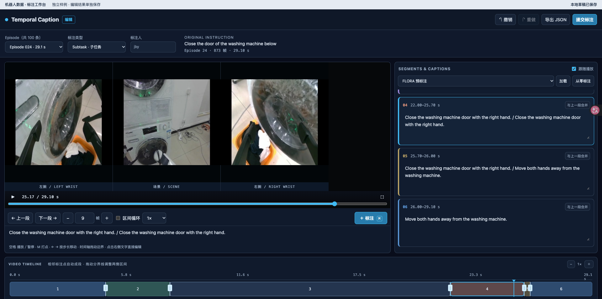

# Embodied Data Annotation Editor

H100 deployment, TempSeg inference and audited model-result import: [reusable workflow (Chinese)](docs/tempseg-workflow.zh-CN.md). Use `./h100ctl open --browser` from the client machine, or `./annotationctl --help` on H100.

**English** | [简体中文](README.zh-CN.md)

Release notes: [2026-11-19 and version history](CHANGELOG.md).

Annotate multi-view robot videos in your browser. Split a recorded episode into action segments and write a caption for each one. Start from scratch or revise FLORA predictions or a saved human annotation.



## Annotation workflow

1. **Choose an episode, annotation type and source.** Sequential Previous/Next follows episode order. Annotation Previous/Next searches in that direction for an episode without submitted human annotations of the current type, wrapping around; if all others are annotated, it stays in place and prompts you to use sequential navigation for repeat annotation. The selected source persists across episodes and loads automatically. If unavailable, another available result is loaded and the dropdown reflects the actual source. Predictions and drafts do not count as human submissions.
2. **Play the video and mark boundaries.** Click a camera view or press Space to play or pause. Click the annotation button or press `M` to split at the current frame. Jump between segments, or set a frame step and tap or hold `−` / `+` to move by that step. Expand the state plots to compare signals with the video.
3. **Refine segments and captions.** Drag shared boundaries to update adjacent segments. Edit captions and fine-action categories, use Shift range selection or select-all, and merge a continuous selection with Undo support.
4. **Save your work.** Browser drafts are saved automatically. Enter an annotator name to submit or export JSON. Submissions are keyed by episode, annotator and annotation type; replacement requires confirmation.
5. **Flag an anomaly for human review.** Click **人工复审**, enter your name and a required note, and submit. Reports mark the whole episode as needing review across both annotation types. Each report is preserved separately; source instructions, current segment edits, and human annotation counts are unchanged. Flagged episodes are not automatically excluded from Next episode. Resolving reports is not implemented yet.

The source selector shows the submitted human annotation count for the current type. It refreshes every 3 seconds while the page is visible, on return to the page, on type changes, and after submission. Refreshing only updates the count and available sources; it preserves your current edits and source selection. Annotation Previous/Next checks the server on every click. Episode option updates pause while the dropdown has focus to preserve its scroll position. Episodes are not reserved: two people who opened the same episode before either submitted can still submit independently.

Click **使用说明** (Help) in the header for naming, submission and overwrite rules, annotation guidance, shortcuts, multi-user synchronization, and draft recovery. Opening the guide pauses playback without changing your annotations.

## Collections and date datasets

Keep the existing startup command. Add a server-side collection directory using the toolbar, scan its immediate date folders, select available dates and confirm. Switch using Collection → Date dataset → Episode. Current drafts are saved before navigation, and each dataset remembers its last episode.

Dates may contain the indexed layout described below, or numbered `episode_XXXXXX` directories, each with its own `meta/info.json` and exactly one indexed episode. Such episode folders must use the same fps. Bare video folders without metadata are shown as unavailable. Source data stays read-only.

Refresh discovers additional dates without navigating away and retains offline entries. Dataset progress counts episodes with human submissions of the current type. Archive makes a dataset read-only on the server; unarchive restores submission access.

Registrations persist in `OUTPUT/.dataset-collections.json`; new labels live under `OUTPUT/collections/<collection-id>/<date>/episode_XXXXXX/`. Existing default labels keep their original paths. Stable dataset IDs isolate drafts, source preferences, vocabularies, requests and last-episode positions. Old default browser workspaces migrate once.

Each date root may provide `caption-vocabulary.json` and `flora-sft-v1.json`. Without them, free text remains available and that model source is absent. The default dataset keeps the existing static-file fallback.

## Caption vocabulary and free text

Subtask cards offer a standard-caption dropdown alongside the editable text field. The default vocabulary contains eight washing/drying instructions. Selecting an item inserts its exact English caption, supports Undo, and leaves boundaries unchanged. Modified captions are marked as custom unless they exactly match a vocabulary item. Repeated choices are allowed.

Import a JSON vocabulary or restore the default using the toolbar. Imports persist per dataset in the current browser across episodes; they do not update other browsers or rewrite existing annotations. Fine action stays free text. See [the default JSON](static/caption-vocabulary.json) for the file format: string `id`, `name`, `version`, and nonempty `items` containing unique string `id` and `caption`, with optional `label_zh`. Files are limited to 1 MB. To update the team default, replace the deployed JSON; users with personal imports can click Restore default. Annotation JSON retains the existing caption field.

## Caption assistance (optional)

Subtask cards provide two independent actions when a model service is configured:

| Button | Purpose |
| --- | --- |
| **精简整理** · Simplify | Deduplicate merged descriptions and turn phases serving the same object and goal into a concise imperative subtask. |
| **多样化改写** · Rewrite | Vary sentence structure and equivalent wording while retaining task facts, for example `stuffed toy` → `plush toy` or `T-shirt` → `tee`. |

First check the segment range against the video. Click an action to open the original caption and a generated suggestion. Edit the suggestion if needed, regenerate with **重新生成 / 换一种表达**, and click **采用建议** (Apply) to replace that caption. Apply updates the browser draft and supports Undo; submit separately when you finish reviewing. Closing the dialog or a failed request leaves the original caption intact. Neither action changes boundaries or submits annotations. Fine action cards do not use these helpers.

Keep the same object, color, hand, spatial relations and success/failure status. A basket, tray and bin are different categories, not interchangeable synonyms. If a merged caption reaches a different object or goal, check the interval rather than deleting that operation to force one subtask. Suggestions can contain factual mistakes; the model only sees text and cannot verify the video.

Only the current caption text is sent to the configured model, together with built-in prompt examples. Videos, original task instructions, state values and annotator names are not sent. Model calls start only when a helper is clicked. Manual annotation works without model configuration.

## Run locally

Python 3.10 or later is required.

```sh
python3 -m venv .venv
source .venv/bin/activate
python -m pip install -r requirements.txt
python full_server.py /path/to/dataset ./annotations
```

Open [http://127.0.0.1:8000/editor](http://127.0.0.1:8000/editor). Choose an output directory outside the dataset directory. The server listens on localhost by default. Annotator names identify submissions; the editor does not authenticate users.

For an existing trusted intranet deployment, use `--host 0.0.0.0 --port 8000` and manage access at the network or reverse proxy layer.

### Configure the text model

Copy [.env.example](.env.example) to an untracked `.env`, fill in your own key, then load it before starting the server:

```sh
cp .env.example .env
# Edit .env and set ANNOTATION_LLM_API_KEY.
set -a
. ./.env
set +a
python full_server.py /path/to/dataset ./annotations
```

The server reads process environment variables; it does not load `.env` automatically.

| Variable | Meaning / default |
| --- | --- |
| `ANNOTATION_LLM_API_KEY` | Server-side model key. Falls back to `DASHSCOPE_API_KEY`. |
| `ANNOTATION_LLM_BASE_URL` | Chat API base URL, ending in `/v1`. Falls back to `DASHSCOPE_BASE_URL`, then `https://dashscope.aliyuncs.com/compatible-mode/v1`. |
| `ANNOTATION_LLM_MODEL` | Model name; default `qwen3.8-max`. |

The current payload uses `/chat/completions`, `response_format: json_object` and Qwen's `enable_thinking: false`. Another provider must support these fields or adapt the payload in [caption_assist.py](caption_assist.py). Keys remain on the server. Missing configuration, busy responses, timeouts and malformed model output are shown in the dialog without replacing the caption. There are at most two concurrent model calls per server process, with a 60-second request timeout.

## Dataset format

This example uses one **2-second, 60-frame episode at 30 fps** with two camera views. The editor reads a LeRobot v3-style layout with a per-episode camera index. Each MP4 contains one complete episode from one camera. Episode numbering starts at `0`.

### Directory layout

```text
example_dataset/
├── meta/
│   ├── info.json
│   └── episodes/
│       └── chunk-000/file-000.parquet
├── videos/
│   ├── observation.images.scene/
│   │   └── chunk-000/file-000.mp4
│   └── observation.images.left_wrist/
│       └── chunk-000/file-000.mp4
├── data/                              # Optional state data
│   └── chunk-000/file-000.parquet
└── output/                            # Optional pre-annotations
    └── flora/episode_000000/caption.json
```

### 1. Dataset configuration · `meta/info.json`

```json
{
  "fps": 30,
  "video_path": "videos/{video_key}/chunk-{chunk_index:03d}/file-{file_index:03d}.mp4",
  "data_path": "data/chunk-{chunk_index:03d}/file-{file_index:03d}.parquet"
}
```

The path templates use `video_key` from the camera list and `chunk_index` and `file_index` from the episode index below. Video files and state files have separate indexes.

### 2. Episode index · `meta/episodes/chunk-000/file-000.parquet`

The JSON object below represents **one Parquet row**. Each key is a separate column. Store the two `viewer/*_json` fields as JSON **strings**, for example by calling `json.dumps()` before writing the Parquet file.

```json
{
  "episode_index": 0,
  "length": 60,
  "tasks": ["Place the block in the tray"],
  "viewer/cameras_json": "[\"observation.images.scene\", \"observation.images.left_wrist\"]",
  "videos/observation.images.scene/chunk_index": 0,
  "videos/observation.images.scene/file_index": 0,
  "videos/observation.images.scene/from_timestamp": 0.0,
  "videos/observation.images.scene/to_timestamp": 2.0,
  "videos/observation.images.left_wrist/chunk_index": 0,
  "videos/observation.images.left_wrist/file_index": 0,
  "videos/observation.images.left_wrist/from_timestamp": 0.0,
  "videos/observation.images.left_wrist/to_timestamp": 2.0,
  "viewer/signals_json": "{\"observation.state\": {\"shape\": [2], \"names\": [\"gripper_x\", \"gripper_width\"]}}",
  "data/chunk_index": 0,
  "data/file_index": 0
}
```

`length` is the frame count. Video timestamps are in seconds, from `0` to `length / fps`. Provide the four `videos/<camera>/...` columns for each camera. The optional `tasks` list supplies the instruction shown in the editor; only the first item is displayed. If you have no state data, omit `viewer/signals_json` and both `data/*` index columns.

### 3. State data (optional) · `data/chunk-000/file-000.parquet`

Write one row per frame. This file has 60 rows, with `frame_index` from `0` to `59`. The two values in each `observation.state` entry correspond to `gripper_x` and `gripper_width` as declared above.

| episode_index | frame_index | observation.state |
| ---: | ---: | --- |
| 0 | 0 | `[0.12, 0.08]` |
| 0 | 1 | `[0.13, 0.08]` |
| 0 | … | … |
| 0 | 59 | `[0.31, 0.04]` |

### 4. Pre-annotations (optional) · `output/flora/episode_000000/caption.json`

```json
{
  "fps": 30,
  "result": {
    "segments": [
      {"start_frame": 0, "end_frame": 30, "caption": "Pick up the block"},
      {"start_frame": 30, "end_frame": 60, "caption": "Place the block in the tray"}
    ]
  }
}
```

Intervals are half-open: `[start_frame, end_frame)`. The first segment covers frames 0–29 and the second covers frames 30–59, so the final boundary is `60`. Segments cover the entire episode without gaps or overlaps. If the pre-annotation frame rate differs from the video frame rate, the editor converts boundaries by time.

Human submissions are written to the output directory passed at startup, for example `annotations/episode_000000/subtask/<annotator-name-hash>.json`. Fine-action submissions go in the sibling `fine_action/` directory.

Anomaly reports are separate sidecars at `annotations/episode_000000/review_flags/<report-id>.json`, with `status`, `annotator`, `annotation_type`, `note`, `created_at`, and a server-read snapshot of the original instruction.

## Optional SFT predictions

Place deployment-specific predictions in `static/flora-sft-v1.json` to add the TempSeg-SFT-v1 source for Subtask. This optional file is excluded from Git. Without it, other annotation functions remain available. Each record must match its episode's frame count and fps; intervals use `[start_frame, end_frame)`. See the [Chinese example](README.zh-CN.md#可选的-sft-预标注) for the JSON structure.

## Tests

```sh
python -m pip install -r requirements-dev.txt
python -m unittest discover -s tests
node --test tests/*.test.mjs
```
