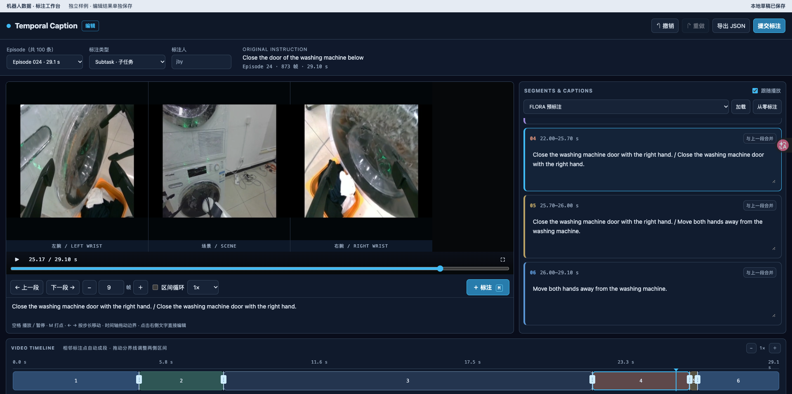

# Embodied Data Annotation Editor

**English** | [简体中文](README.zh-CN.md)

Annotate multi-view robot videos in your browser. Split a recorded episode into action segments and write a caption for each one. Start from scratch or revise FLORA predictions or a saved human annotation.



## Annotation workflow

1. **Choose an episode and annotation type.** Select Subtask or Fine action. Click **Next episode** to prefer an episode with no submitted human annotation of that type, searching forward and wrapping around; if the other episodes are all annotated, it stays on the current page and prompts you to choose manually for repeat annotation. Model labels and browser drafts do not count as submissions. Your draft and annotation type are retained when switching. To start from an existing result, choose it in the dropdown on the right and click Load.
2. **Play the video and mark boundaries.** Click a camera view or press Space to play or pause. Click the annotation button or press `M` to split at the current frame. Jump between segments, or set a frame step and tap or hold `−` / `+` to move by that step. Expand the state plots to compare signals with the video.
3. **Refine segments and captions.** Drag a shared boundary on the timeline to update both adjacent segments. Edit captions and fine-action categories in the right panel, or merge a segment with the previous one.
4. **Save your work.** The browser saves drafts automatically. Enter an annotator name to submit, or export the annotation as JSON. Submissions are keyed by episode, annotator, and annotation type. Replacing an existing submission requires confirmation.

The source selector shows the submitted human annotation count for the current type. It refreshes every 3 seconds while the page is visible, on return to the page, on type changes, and after submission. Refreshing only updates the count and available sources; it preserves your current edits and source selection. Next episode checks the server on every click. Episodes are not reserved: two people who opened the same episode before either submitted can still submit independently.

## Run locally

Python 3.10 or later is required.

```sh
python3 -m venv .venv
source .venv/bin/activate
python -m pip install -r requirements.txt
python full_server.py /path/to/dataset ./annotations
```

Open [http://127.0.0.1:8000/editor](http://127.0.0.1:8000/editor). Choose an output directory outside the dataset directory. The server listens on localhost by default. Annotator names identify submissions; the editor does not authenticate users.

## Dataset format

This example uses one **2-second, 60-frame episode at 30 fps** with two camera views. The editor reads a LeRobot v3-style layout with a per-episode camera index. Each MP4 contains one complete episode from one camera. Episode numbering starts at `0`.

### Directory layout

```text
example_dataset/
├── meta/
│   ├── info.json
│   └── episodes/
│       └── chunk-000/file-000.parquet
├── videos/
│   ├── observation.images.scene/
│   │   └── chunk-000/file-000.mp4
│   └── observation.images.left_wrist/
│       └── chunk-000/file-000.mp4
├── data/                              # Optional state data
│   └── chunk-000/file-000.parquet
└── output/                            # Optional pre-annotations
    └── flora/episode_000000/caption.json
```

### 1. Dataset configuration · `meta/info.json`

```json
{
  "fps": 30,
  "video_path": "videos/{video_key}/chunk-{chunk_index:03d}/file-{file_index:03d}.mp4",
  "data_path": "data/chunk-{chunk_index:03d}/file-{file_index:03d}.parquet"
}
```

The path templates use `video_key` from the camera list and `chunk_index` and `file_index` from the episode index below. Video files and state files have separate indexes.

### 2. Episode index · `meta/episodes/chunk-000/file-000.parquet`

The JSON object below represents **one Parquet row**. Each key is a separate column. Store the two `viewer/*_json` fields as JSON **strings**, for example by calling `json.dumps()` before writing the Parquet file.

```json
{
  "episode_index": 0,
  "length": 60,
  "tasks": ["Place the block in the tray"],
  "viewer/cameras_json": "[\"observation.images.scene\", \"observation.images.left_wrist\"]",
  "videos/observation.images.scene/chunk_index": 0,
  "videos/observation.images.scene/file_index": 0,
  "videos/observation.images.scene/from_timestamp": 0.0,
  "videos/observation.images.scene/to_timestamp": 2.0,
  "videos/observation.images.left_wrist/chunk_index": 0,
  "videos/observation.images.left_wrist/file_index": 0,
  "videos/observation.images.left_wrist/from_timestamp": 0.0,
  "videos/observation.images.left_wrist/to_timestamp": 2.0,
  "viewer/signals_json": "{\"observation.state\": {\"shape\": [2], \"names\": [\"gripper_x\", \"gripper_width\"]}}",
  "data/chunk_index": 0,
  "data/file_index": 0
}
```

`length` is the frame count. Video timestamps are in seconds, from `0` to `length / fps`. Provide the four `videos/<camera>/...` columns for each camera. The optional `tasks` list supplies the instruction shown in the editor; only the first item is displayed. If you have no state data, omit `viewer/signals_json` and both `data/*` index columns.

### 3. State data (optional) · `data/chunk-000/file-000.parquet`

Write one row per frame. This file has 60 rows, with `frame_index` from `0` to `59`. The two values in each `observation.state` entry correspond to `gripper_x` and `gripper_width` as declared above.

| episode_index | frame_index | observation.state |
| ---: | ---: | --- |
| 0 | 0 | `[0.12, 0.08]` |
| 0 | 1 | `[0.13, 0.08]` |
| 0 | … | … |
| 0 | 59 | `[0.31, 0.04]` |

### 4. Pre-annotations (optional) · `output/flora/episode_000000/caption.json`

```json
{
  "fps": 30,
  "result": {
    "segments": [
      {"start_frame": 0, "end_frame": 30, "caption": "Pick up the block"},
      {"start_frame": 30, "end_frame": 60, "caption": "Place the block in the tray"}
    ]
  }
}
```

Intervals are half-open: `[start_frame, end_frame)`. The first segment covers frames 0–29 and the second covers frames 30–59, so the final boundary is `60`. Segments cover the entire episode without gaps or overlaps. If the pre-annotation frame rate differs from the video frame rate, the editor converts boundaries by time.

Human submissions are written to the output directory passed at startup, for example `annotations/episode_000000/subtask/<annotator-name-hash>.json`. Fine-action submissions go in the sibling `fine_action/` directory.

## Tests

```sh
python -m unittest discover -s tests
node tests/segments.test.mjs
node tests/annotations.test.mjs
```
