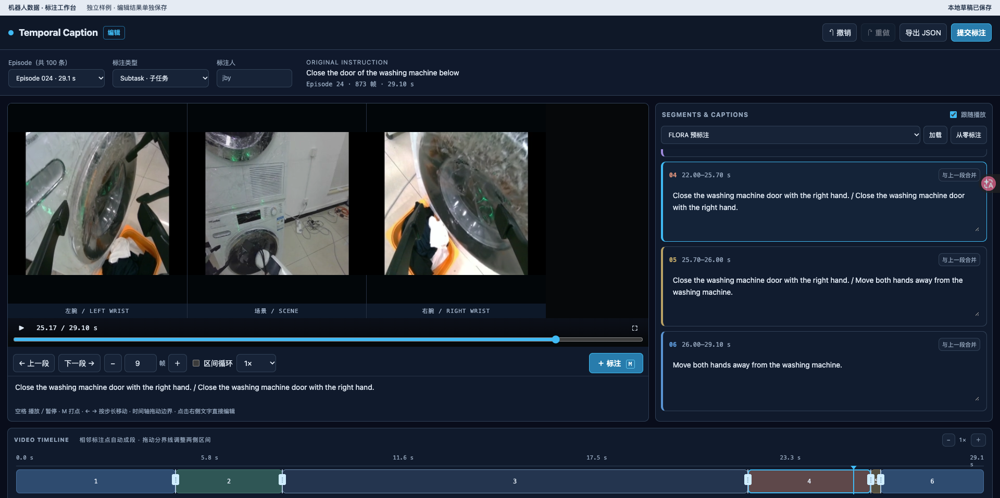

# Embodied Data Annotation Editor

[English](README.md) | **简体中文**

在浏览器里同步查看机器人多视角视频，把一条操作记录切成动作片段，为每段填写 caption。可从空白时间轴开始，也可以加载 FLORA 预标注或已有人工标注再修订。



## 怎么标注

1. **选择 episode 和标注类型。** 顶部选择子任务（Subtask）或细粒度动作（Fine action），右侧下拉框可加载已有结果。点击「下一条」优先切到当前类型下尚无人提交人工标注的 episode，向后查找并循环；其余都已标注时停留并提示，需要复标时手动选择。模型预标注与本地草稿不计入已提交，切换会保留草稿和当前标注类型。
2. **看视频、切片段。** 点击画面或按空格播放／暂停。点击「标注」或按 `M` 在当前帧切段。用「上一段／下一段」跳转，或输入帧步长并短按、长按 `−`／`＋` 定位。可展开状态曲线对照视频。
3. **调整边界和文字。** 拖动底部时间轴的分界线，两侧片段会一起更新。右侧可直接改 caption、填写细粒度动作类别，或把当前段与上一段合并。
4. **保存结果。** 草稿自动保存在当前浏览器。填写标注人后可提交，也可以导出 JSON。提交按 episode、标注人、标注类型区分，覆盖已有提交前会询问。

5. **标记异常并提交人工复审。** 点击「人工复审」，填写署名和必填的异常备注后提交。标记属于整条 episode，两种类型都能看到。每次提交独立保留，不修改原始指令、当前分段，也不增加人工标注数。异常条目不会自动从「下一条」排除；复审处理与解除标记尚未实现。

来源下拉框旁显示当前类型的人工标注数，页面可见时每 3 秒同步，回到页面、切换类型和提交后也更新。刷新只更新数字与可加载来源，保留当前编辑和来源选择。「下一条」每次点击实时查询服务器。episode 不占用：两人在提交前已打开同一条时，仍可各自独立提交。

点击顶部「使用说明」查看署名与“登录”、提交覆盖、标注建议、快捷键、多人同步和草稿恢复规则。打开说明会暂停视频，保留当前标注。

## 运行

需要 Python 3.10 或更新版本。

```sh
python3 -m venv .venv
source .venv/bin/activate
python -m pip install -r requirements.txt
python full_server.py /path/to/dataset ./annotations
```

打开 [http://127.0.0.1:8000/editor](http://127.0.0.1:8000/editor)。输出目录应位于数据集目录之外。服务默认监听本机；标注人姓名用于署名，服务未提供账号认证。

## 数据格式

下面用一条 **2 秒、30 fps、60 帧、两个相机视角**的 episode 举例。编辑器读取带相机索引的 LeRobot v3 风格目录，每个 MP4 对应一个视角的一条完整 episode。编号从 `0` 开始。

### 目录结构

```text
example_dataset/
├── meta/
│   ├── info.json
│   └── episodes/
│       └── chunk-000/file-000.parquet
├── videos/
│   ├── observation.images.scene/
│   │   └── chunk-000/file-000.mp4
│   └── observation.images.left_wrist/
│       └── chunk-000/file-000.mp4
├── data/                              # 可选，状态曲线数据
│   └── chunk-000/file-000.parquet
└── output/                            # 可选，已有预标注
    └── flora/episode_000000/caption.json
```

### 1. 数据集配置 · `meta/info.json`

```json
{
  "fps": 30,
  "video_path": "videos/{video_key}/chunk-{chunk_index:03d}/file-{file_index:03d}.mp4",
  "data_path": "data/chunk-{chunk_index:03d}/file-{file_index:03d}.parquet"
}
```

路径模板中的 `video_key` 来自相机列表，`chunk_index` 和 `file_index` 来自下面的 episode 索引。状态文件和视频使用各自的索引。

### 2. Episode 索引 · `meta/episodes/chunk-000/file-000.parquet`

下方 JSON 展示 **Parquet 的一行**，每个键都是独立列。两个 `viewer/*_json` 字段存的是 JSON **字符串**，写入 Parquet 前先用 `json.dumps()` 序列化。

```json
{
  "episode_index": 0,
  "length": 60,
  "tasks": ["把方块放进托盘"],
  "viewer/cameras_json": "[\"observation.images.scene\", \"observation.images.left_wrist\"]",
  "videos/observation.images.scene/chunk_index": 0,
  "videos/observation.images.scene/file_index": 0,
  "videos/observation.images.scene/from_timestamp": 0.0,
  "videos/observation.images.scene/to_timestamp": 2.0,
  "videos/observation.images.left_wrist/chunk_index": 0,
  "videos/observation.images.left_wrist/file_index": 0,
  "videos/observation.images.left_wrist/from_timestamp": 0.0,
  "videos/observation.images.left_wrist/to_timestamp": 2.0,
  "viewer/signals_json": "{\"observation.state\": {\"shape\": [2], \"names\": [\"gripper_x\", \"gripper_width\"]}}",
  "data/chunk_index": 0,
  "data/file_index": 0
}
```

`length` 是帧数，视频时间戳以秒为单位，范围是 `0` 到 `length / fps`。每个相机分别填写四个 `videos/<camera>/...` 字段。`tasks` 可选，页面显示列表中的第一项。没有状态数据时，可省略 `viewer/signals_json` 和两个 `data/*` 索引列。

### 3. 状态曲线（可选） · `data/chunk-000/file-000.parquet`

每帧一行。这个例子有 60 行，`frame_index` 为 `0–59`；每行 `observation.state` 有两个值，分别对应上面的 `gripper_x` 和 `gripper_width`。

| episode_index | frame_index | observation.state |
| ---: | ---: | --- |
| 0 | 0 | `[0.12, 0.08]` |
| 0 | 1 | `[0.13, 0.08]` |
| 0 | … | … |
| 0 | 59 | `[0.31, 0.04]` |

### 4. 预标注（可选） · `output/flora/episode_000000/caption.json`

```json
{
  "fps": 30,
  "result": {
    "segments": [
      {"start_frame": 0, "end_frame": 30, "caption": "夹起方块"},
      {"start_frame": 30, "end_frame": 60, "caption": "把方块放进托盘"}
    ]
  }
}
```

区间采用 `[start_frame, end_frame)`。第一段覆盖第 0–29 帧，第二段覆盖第 30–59 帧，末尾边界写 `60`。各段连续覆盖整条 episode；预标注帧率不同时，编辑器按时间换算到视频帧率。

人工提交写到启动命令指定的独立目录，例如 `annotations/episode_000000/subtask/<标注人姓名的哈希>.json`。`fine_action` 类型保存到同级的 `fine_action/` 目录。

异常备注独立保存到 `annotations/episode_000000/review_flags/<report-id>.json`，包含状态、署名、标注类型、备注、提交时间和服务器读取的原始指令快照。

## 测试

```sh
python -m unittest discover -s tests
node tests/segments.test.mjs
node tests/annotations.test.mjs
node tests/review.test.mjs
```
